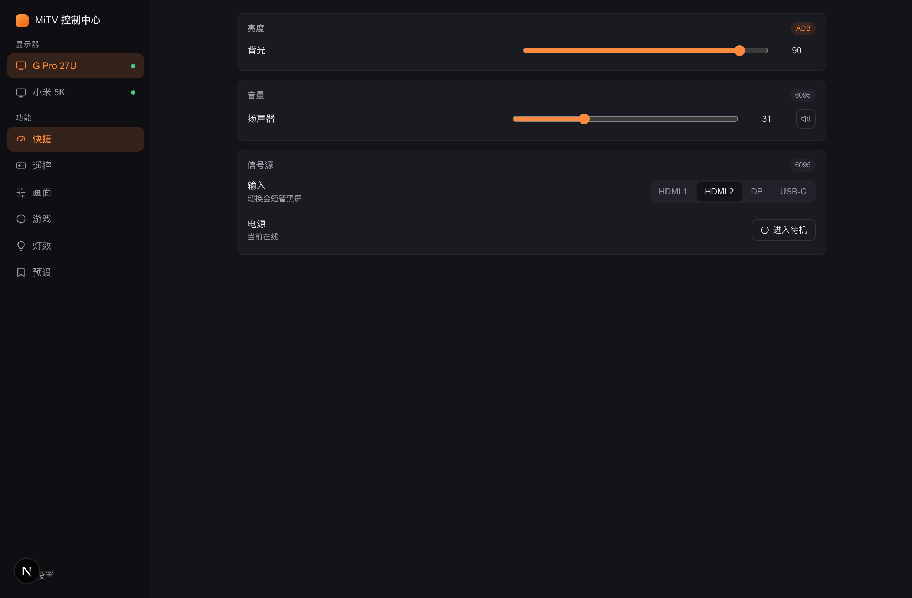
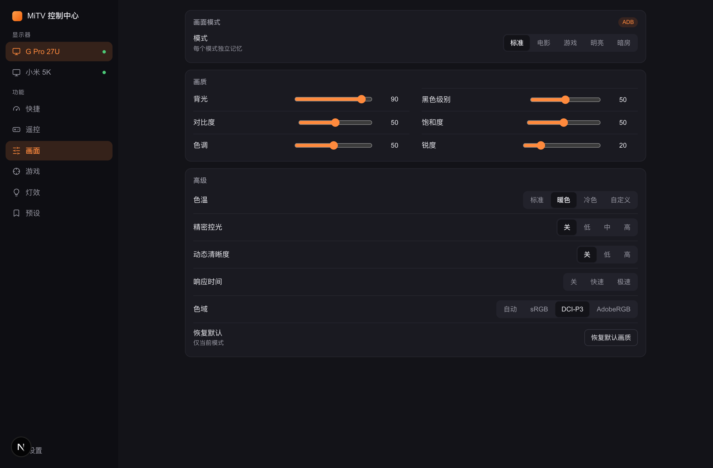
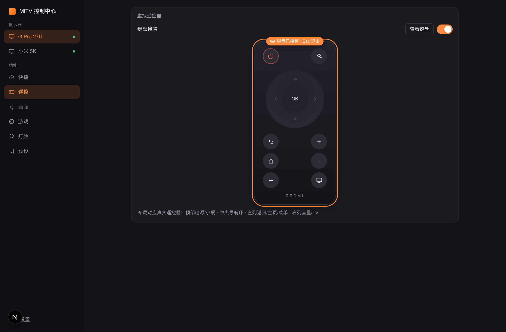
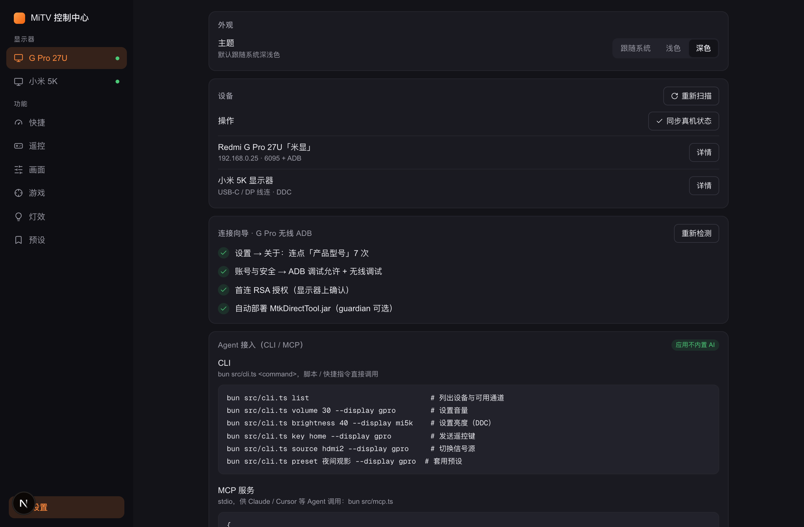

<div align="center">

# MiTV 控制中心 · MiTV Control Center

**Redmi 显示器 G Pro 27U / 小米显示器的本地控制中心**
音量 · 背光亮度 · 画面模式 · 色温 · 精密控光 · FreeSync · 320Hz · 游戏准星 · 屏幕炫彩灯 —— 一个网页全搞定

[](https://bun.sh)
[](https://nextjs.org)
[](https://www.typescriptlang.org)
[](https://www.prisma.io)
[](LICENSE)

[快速开始](#-快速开始) · [功能](#-功能总览) · [三通道架构](#-三通道控制架构) · [真机适配](#-真机适配与协议来源) · [安全与免责](#-安全与免责)



</div>

## 📖 这是什么

**MiTV 控制中心**是一个运行在本机的开源显示器控制软件，为 **Redmi 显示器 G Pro 27U 2026 款**（内部型号 MiTV-MFFU1 / beekeeper，HyperOS）以及普通小米显示器提供超越官方遥控器与米家的操控能力：

- 🎚️ **音量**：0-100 精确滑块（macOS 键盘无法调节 HDMI 显示器音量的完美解法）
- 💡 **背光亮度**：智能款走 ADB 直写 MTK 寄存器，普通款走 DDC/CI——两种硬件两条路
- 🖼️ **画面全项**：画面模式、黑色级别、对比度、饱和度、色调、锐度、色温、精密控光、动态清晰度、响应时间、色域
- 🎮 **游戏功能**：FreeSync、准星、动态准星、狙击镜、夜视、FPS 计数器、320Hz EDID 模式
- 🌈 **屏幕炫彩灯**：照明/纯色/屏幕同色/七彩梦境，真实 5 色系（冰蓝/流金/天青/草地/日落）与三挡色温
- 📱 **手机远程**：同一 Wi-Fi 浏览器直接打开，布局自适应
- 🤖 **Agent 友好**：CLI 与 MCP Server 暴露全部能力，应用本身不内置 AI，任何 Agent（Claude、Cursor 等）都能驱动它
- ⌨️ **键盘接管遥控**：激活后方向键/Enter/Backspace 直接变成虚拟遥控器，Esc 一键退出
- 🔄 **真机状态同步**：程序没运行时被遥控器改过配置？一键读回真实状态

## 📸 界面

| 快捷面板 | 画面设置 |
| --- | --- |
|  |  |
| **虚拟遥控器（键盘接管）** | **设置与设备管理** |
|  |  |

## 🧭 三通道控制架构

```
┌─ 本地服务（Next.js 16 · UI + API 同进程 · 端口 8666）─────────────┐
│  桌面浏览器 / 手机 PWA / CLI（mitv） / MCP Server ← 共享 core 层   │
└────────────┬──────────────────┬─────────────────┬────────────────┘
        6095 HTTP（零配置）   ADB :5555（深度控制）   DDC/CI（视频线）
             ▼                   ▼                    ▼
      音量·遥控·电源·信号源   画面·游戏·炫彩灯·亮度   普通显示器亮度
```

| 通道 | 零配置 | 控制范围 | 说明 |
| --- | --- | --- | --- |
| **6095 HTTP** | ✅ | 音量、遥控键、电源、HDMI 信号源 | 设备内置 MiTV Assistant Server，无需任何设置 |
| **ADB** | 需开启无线 ADB | 画面/游戏/灯效全项、MTK 寄存器、320Hz | 经 `settings` + TvService JNI；应用自动部署 helper |
| **DDC/CI** | ✅（走现有视频线） | 普通显示器亮度 | 只信校验和合法应答，垃圾帧全部丢弃 |

> 智能款的亮度优先走 ADB（画面层真实背光），DDC 作为普通显示器的唯一通道——三条路互补，坏一条不瘫。

## 🚀 快速开始

```bash
bun install
bun run dev          # http://localhost:8666
```

- 手机：同一 Wi-Fi 浏览器打开 `http://<电脑IP>:8666`
- Agent：`bun src/cli.ts list` 或在 mcpServers 里加 `{ "command": "bun", "args": ["run", "mcp"] }`
- 状态同步：设置 → 设备 →「同步真机状态」

首次使用 G Pro 的深度功能需在显示器上开启无线 ADB（应用内置图文向导）：设置 → 关于 → 连点「产品型号」7 次 → 账号与安全 → ADB 调试允许。

## 🔧 技术栈

Next.js 16（App Router，UI 与本地 API 同进程，SSE 推送状态）· TypeScript 7（原生编译器）· Bun（运行/包管理/测试）· Prisma + SQLite（设备/预设/操作日志）· 三通道实现于 `src/core`（UI/CLI/MCP 三入口共享）。

## 🎯 真机适配与协议来源

以下协议均在 **Redmi G Pro 27U 2026（HyperOS 3.0.120）** 上逐项实测，参考了这些优秀的开源项目：

- [MiTV-Remote](https://github.com/pengchujin/MiTV-Remote) —— 6095 协议
- [Mimonitor_Toolbox](https://github.com/YiHoooong/Mimonitor_Toolbox) —— ADB 深度控制 / MTK JNI / 炫彩灯
- [AndroidDisplayVoiceBridge](https://github.com/Evilom/AndroidDisplayVoiceBridge) —— 语音服务线索
- [Crisp](https://github.com/didriksg/Crisp)（MIT）—— DDC 防御设计参考

普通小米显示器（非智能款）仅 DDC 亮度可用；其他型号未测试，欢迎反馈。

## ⚠️ 安全与免责

- 6095 接口**无鉴权**（小米设计），同网段设备可直接控制你的显示器——本应用无法改变这一点，请勿将端口暴露到公网
- 深度功能依赖 ADB，小米未来固件可能封堵（通道化设计：基础功能不受影响）
- 本项目与小米/Redmi 无关，仅供学习与个人使用

## 🖥️ 桌面客户端（Electron）

```bash
bun run build && bun run desktop:build:main   # Next standalone + 主进程编译
ELECTRON_MIRROR=https://npmmirror.com/mirrors/electron/ bunx electron-builder --dir
./scripts/assemble-desktop.sh                  # 组装 standalone/resources/图标
open "release/mac-arm64/MiTV 控制中心.app"
```

- 托盘常驻（关窗不退出，托盘菜单可唤出/退出）；单实例锁定
- 内嵌 Next standalone 服务（Electron 自带 Node 运行，零外部依赖）与 ddc-helper
- 首次运行自动把数据库模板落到 `~/Library/Application Support/mitv/`
- 当前为未签名 dir 包（本机可用）；正式分发需开发者证书签名

## 🗺️ Roadmap

- [x] Electron 桌面壳（托盘常驻 + 内嵌服务）
- [ ] 开机自启 + 正式签名分发（dmg/NSIS 安装包）
- [ ] PWA manifest 与局域网访问令牌
- [ ] 自动任务（按时段套用预设）、HDR/SDR 联动
- [ ] 小爱同学经 Home Assistant 桥接

## 📄 License

[MIT](LICENSE)
